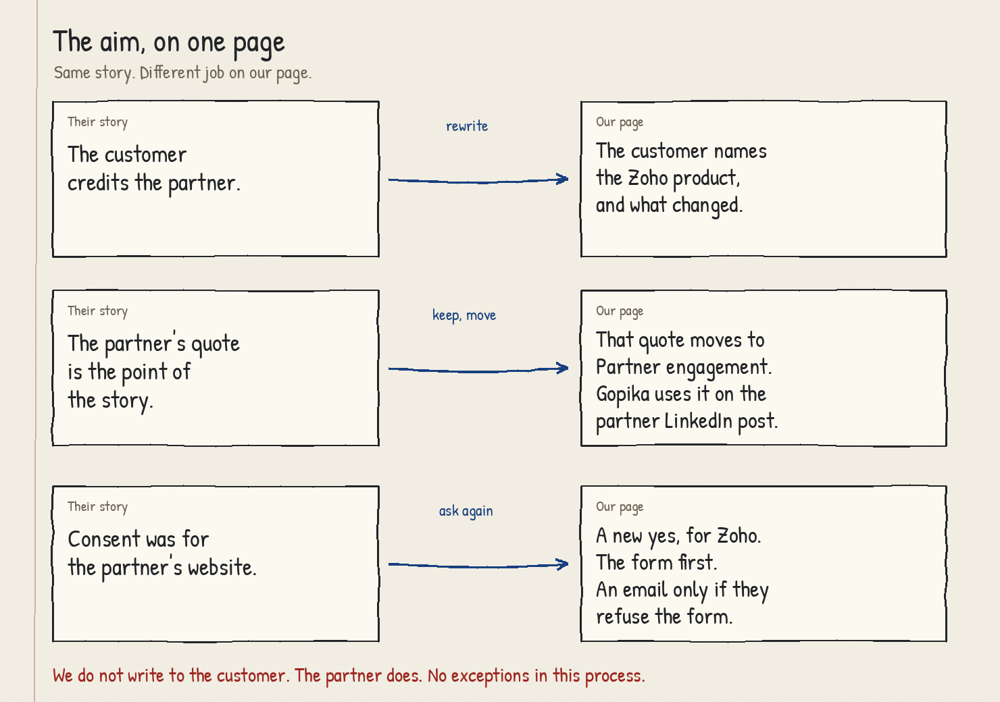
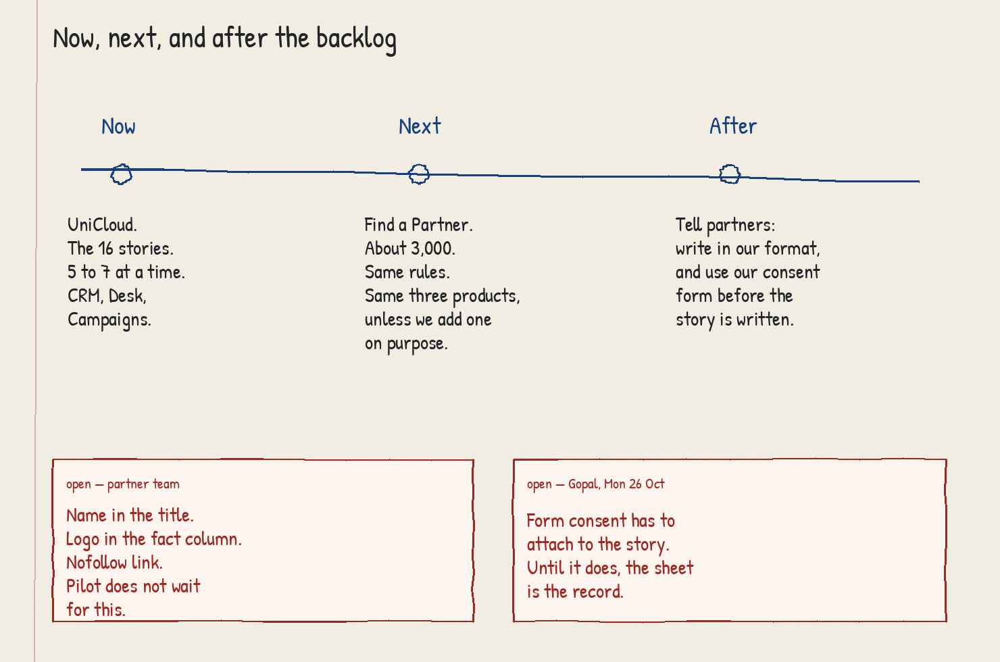
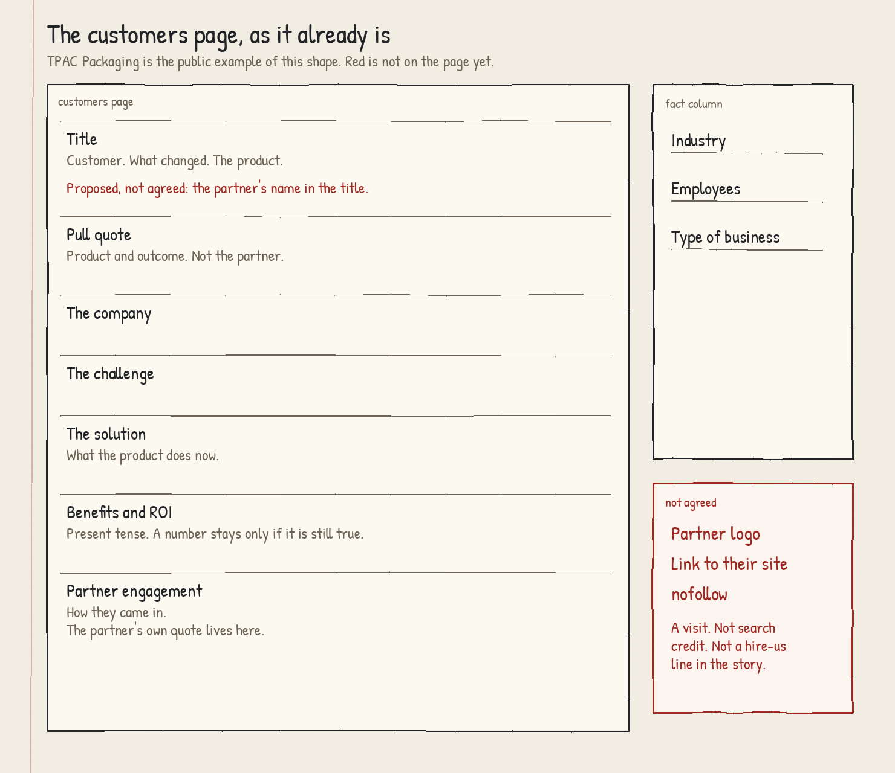
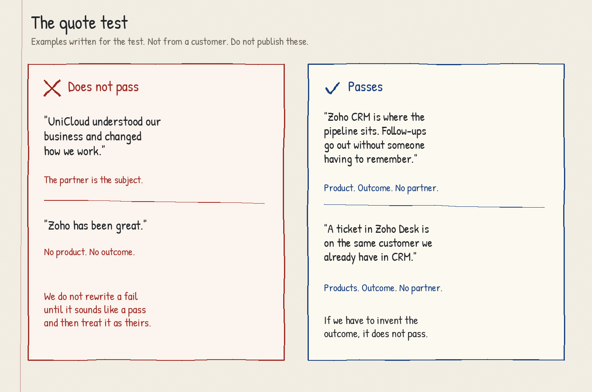
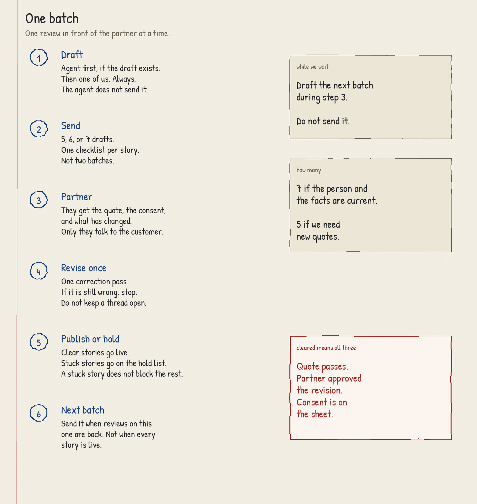
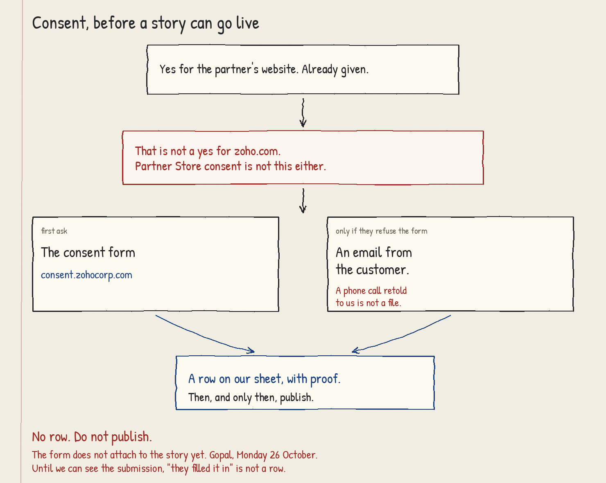
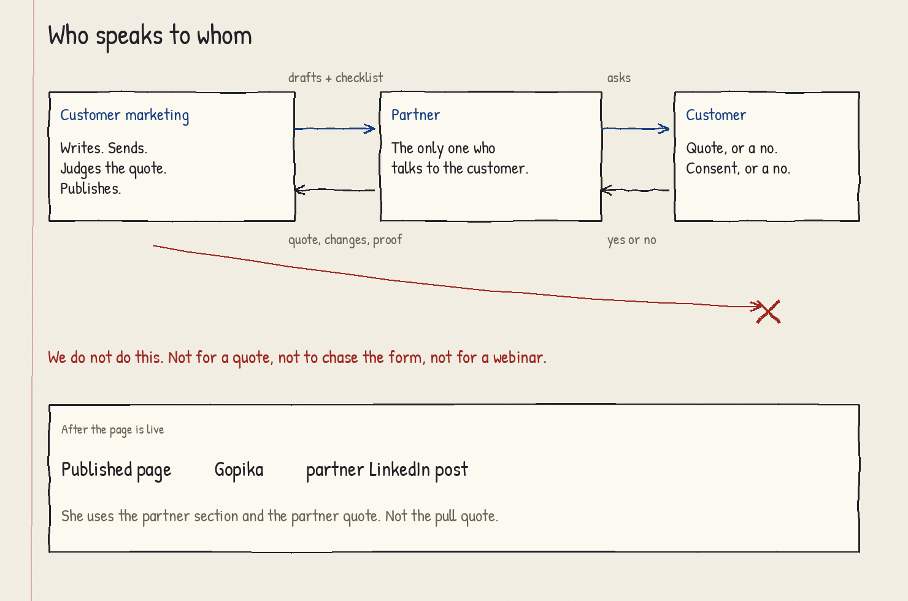

# Republishing partner case studies

Draft for Gopal. 23 October 2026.

Not for UniCloud until the decisions at the end are answered.

The Catalyst rewrite is already being built with Aayisha. This note does not ask to start that.

## 1. Aim

Take case studies a partner has already published. Put them on our customers page, in our format.

- The customer's quote names the Zoho product and the outcome.
- The partner stays in the story, in Partner engagement.
- We do not contact the customer. The partner does.
- Nothing goes live without permission for our website, on file.

### Short term

- UniCloud first. The 16 stories from the call. Reviewed 5 to 7 at a time.
- CRM, Desk, and Campaigns only.
- One batch in front of the partner at a time.
- Until the consent form attaches to a story on its own, a sheet is the record.
- The pilot does not wait for the agent. The 16 are also the set we check the agent against.

### Long term

- The same rules for the stories on Find a Partner. About 3,000. That is your figure, not a count we have closed.
- After that backlog: a new story is written in our format, and the consent form is filled before we write it.
- Partner name in the title. Partner logo, and a nofollow link, in the fact column. Not agreed. That needs the partner team, and a change to the page template.

### Not this work

- Original case studies. A new customer goes to the marketers who already write those with partners. We make the introduction.
- A second submission to Partner Store. An approved study cannot be resubmitted. A copy of one can be rejected.
- More tier points. The partner help page gives 10 points for an approved study, and stops at 5 studies. The score stays as Partner Store left it.

No date on the 3,000. After the first UniCloud batch we will know how long a quote and a consent take. The date gets set then.

## 2. What the partner gets, and what we ask

Gets, now:

- The page still names who implemented it, in Partner engagement.
- Their own quote is what Gopika uses on the partner LinkedIn post.
- The tier points they already earned stay where they are.

Asked:

- A customer quote about the Zoho product and the outcome. Not about the partner.
- A new permission for our website.
- A review of the draft.
- They do every conversation with the customer.

Not offered yet. Do not mention these to UniCloud:

- Their name in the title.
- Their logo in the fact column.
- A nofollow link to their site. The reader can visit. We do not pass search credit. It is not a "hire this partner" line in the story.

Their own case-study template tells them to end on a call to action to their website. That call to action does not come onto our page. Partner engagement is the credit. The link, if it is agreed, is the visit.

## 3. What we already told UniCloud

These stand.

- We rewrite. They review.
- We do not go to their customers.
- CRM, Desk, Campaigns.
- The 16 stories, in batches of 5 to 7, so neither side is buried in review.
- The customer quote speaks to the Zoho product and the outcome. ROI. A process that runs end to end. The partner's name stays out of that quote.
- Their quote is kept, in the partner section. Gopika uses it when she posts the published story.
- If the person quoted has left, they find who can quote now. They can refresh their own page at the same time. We do not refresh it for them.
- If a fact has changed, they tell us. We write in the present tense.
- Permission for our site is separate. The form is [https://consent.zohocorp.com/#Consents](https://consent.zohocorp.com/#Consents). If the customer refuses the form, an email is enough, provided we can file it.
- We send the first 5 to 7 drafts. They come back with quotes and consent. We publish what is approved, then send the next batch.
- A new customer, for a story that does not exist yet, is a different lane. We connect them to a marketer.

## 4. The page we write to

The customers page already has a shape. The [TPAC Packaging story](https://www.zoho.com/crm/crmplus/customers/tpac-packaging.html) is a public example of that shape. We are not reopening TPAC.

- Title. The customer, what changed, the product. The partner is not in the title today.
- Pull quote.
- The company.
- The challenge.
- The solution.
- Benefits and ROI.
- Partner engagement. How the partner came in.
- Fact column. Industry, employees, type of business.

### Where the partner's text goes

- Their title card becomes our title. The outcome and the product.
- Overview and executive summary become The company. A quote moves up only if it passes the test in the next section.
- Their problem becomes The challenge.
- Evaluation, proposed solution, and implementation become The solution, written as what the product does now. How the partner did the work moves to Partner engagement.
- Their results become Benefits and ROI. Present tense. A number comes across only if they say it is still true.
- Their quote, and how they were brought in, become Partner engagement.
- Their closing customer quote becomes the pull quote, if it passes. If it praises the partner, we ask for another quote. We do not rewrite a failing sentence into a pass and put their name under it.

## 5. The quote

A quote passes when a Zoho product is named, an outcome is named, and the partner is not named.

It fails when the partner is the subject, or when the sentence is praise with no product and no outcome.

The four lines below were written for this test. They are not from a customer. Do not publish them.

We do not invent an outcome to push a weak quote over the line. That story waits, or it goes on the hold list.

The name on the quote has to be a person who will stand by it. If they have left, the old sentence does not get a new name. The partner gets a new sentence from someone who is there.

## 6. The batch

1. Draft. The agent, if a draft exists. Then one of us, every time. The agent does not email the partner.
2. Send one batch. Five, six, or seven drafts. One checklist per story.
3. The partner gets the quote, the consent, and the corrections. They are the only people who talk to the customer.
4. We revise once. If the second draft is still wrong, we stop and talk. We do not run an open edit on the story.
5. A story that is clear is published. A story that is not goes on the hold list. It does not hold the others back.
6. The next batch goes when the reviews on this one are back. Not when every story is live. We can draft the next batch while we wait. We do not send it early.

Seven when the person quoted is still there and the facts are current. Five when we need new quotes. That is our rule, inside the 5 to 7 already promised.

A story is clear only when all three are true: the quote passes, the partner has approved the revision, and consent is on the sheet.

## 7. Consent

They agreed to the partner's website. Partner Store also tells the partner to have consent before submission and reuse. See the [partner help page](https://www.zoho.com/store/partner/help/partner-company-manage-case-studies.html).

Neither of those is our consent form. The form does not attach itself to the case study. You said you would come back with a way to do that by Monday 26 October.

Until then, the sheet is the record. No row, no publish.

The permission has to cover:

- The customer's name.
- The company name.
- The products. If it was sold as a bundle, name the products in the story. CRM, Desk, Campaigns. Not only the bundle.
- Logo and images, if we use any. The form already asks. An email used instead has to say it.

First ask is the form. If they say they have already consented, the partner gets a written reply from the customer. We file that reply. A phone call the partner describes to us is not a file.

Proof, until Monday:

- Email: the customer's reply, forwarded to us. We can file that ourselves.
- Form: we can file it only if we can point at the submission. "The partner says it was filled in" is not a row. What we should point at is decision 1.

We can finish the words before consent arrives. We cannot publish before it arrives.

### The sheet

One row per story. Open the sheet before the first draft goes to UniCloud.

- Partner
- Their title, and their URL
- Our working title
- Customer name, as it will appear
- Company
- Products named in the consent
- Form or email
- Date
- Where the proof is
- Our URL, once the page is live
- Status: draft, with the partner, revising, cleared, published, held
- If held, the reason, in one line

When the form starts attaching on its own, this sheet is the backlog to attach. We do not delete it first.

## 8. Who does what

Customer marketing. Rewrite. Send the batch. Judge the quote. Publish only from a cleared row. Introduce the original-story marketers when a partner has a new customer.

The partner. Every conversation with the customer. A new quote if the old person has left. What has changed. The review. Chasing consent.

Gopika. After the page is live. The LinkedIn post, from Partner engagement and the partner quote. Not from the pull quote. She does not post a story that is still in review.

Aayisha and customer marketing. The agent that writes the first draft and raises the flags below. It does not publish. It does not file consent.

Partner team. The title, the logo, the nofollow link. They are not in the UniCloud loop.

Gopal. How a form consent attaches to a story. This note.

There is no path from us to the customer. Not for a quote, not to chase the form, not to ask them onto a webinar.

## 9. The agent

Input. The partner's published page, or the text they submitted to Partner Store.

Output. A draft already broken into the sections in section 4. And a flag list. Problems are listed. They are not quietly edited away.

Flags:

- The quote names the partner.
- The quote names no Zoho product.
- The quote has no outcome.
- We do not know if the person quoted is still there.
- A date, a system, or a number may be stale.
- The product is outside CRM, Desk, and Campaigns.
- A bundle is named and the products inside it are not.
- There is no partner quote to move.
- The only credit the partner gets in the source is a call to action.

The draft does not add a number the source does not contain.

A person reads every draft before it goes to the partner. If the agent is not ready for batch 1, we draft that batch ourselves. We do not wait.

## 10. Hold list

A story is held, and the reason is written on the sheet, when:

- No one at the company will give a quote.
- The customer will not fill the form and will not send the email.
- The quote cannot pass unless we invent the outcome.
- The product is outside CRM, Desk, and Campaigns.
- The draft is still wrong after one revision.
- We cannot see proof of the form, and there is no email.

A held story is not dropped. It is not part of the next batch's count. It comes back when the reason is gone. If we add a product later, the stories held for that product are the first ones we pick up.

The partner hears which story is held, and why, in one line.

A story that is in the UniCloud 16 and also on Find a Partner is done once.

## 11. After the 3,000

One message to partners, sent when the Find a Partner backlog has been republished:

- A new story is written in our sections. It is not converted afterwards.
- The customer fills our consent form as part of writing it.
- The point is to stop arriving at publish day without permission.

You said this message goes out after all of the stories are done. Decision 2 asks you to confirm that. If we wait for the last story, every new story signed during the backlog still has today's permission problem.

## 12. The webinar series

Separate programme. Partner-led, Zoho CRM, September to December 2026. Julia and Sharanya. It is not run from this process.

The only join. A presenting partner is asked to bring a real use case. A story we have already published, with a cleared row on the sheet, can be that use case.

We do not hold a case study so it can debut in a webinar. We do not approach that customer. If anyone does, the partner does.

## 13. Decisions

1. Consent, Monday 26 October. What do we store so a form submission can be attached to the story later? Until we can see a submission, the partner's word that the form was filled will not clear a story. If Partner Store consent should count instead, say so, and say what proof we can open. Otherwise it does not clear a row.

2. The message about our format and the consent form. After all ~3,000, as you said? Or when each partner's own stories are done?

3. Title, logo, nofollow link. We take these to the partner team. The UniCloud pilot uses the page as it is. The credit is added when the template can do it. Confirm both.

4. Products stay CRM, Desk, and Campaigns until we add one on purpose.

5. Inside a batch, a finished story is published. It is not held for a stuck one. The next batch waits for the reviews, not for every story to be live. We will say this to UniCloud in the batch note. It is a clarification of "once approved, we'll publish and move on." Confirm we can say it.

## What the first batch note contains

Sent only after the five decisions above.

- The drafts.
- The checklist. One per story. Appendix A.
- The quote test, with the four examples.
- The form link, and the email in Appendix B if they will not fill the form.
- A person who has left cannot stay as the name on the quote.
- We publish the stories they approve. A story that cannot be approved yet is held. We say why. It does not stop the rest.
- The next set goes out when we have their review on this one.

## Appendix A. Checklist

One per story. The partner returns it.

- Title on their site, and the URL
- Person to quote: name, role, still at the company
- If that person has left: the new person's name and role
- The quote
- What in the old story is no longer true
- Products, if it was sold as a bundle
- Consent: form submitted, or the email attached
- Anything that must not be published

## Appendix B. Email, if they refuse the form

The partner sends this. The customer replies. The partner forwards the reply to us. We do not send it ourselves.

> Subject: Permission to publish your story on Zoho's website
>
> We are working with Zoho on a version of the story that is already on our website. Their version is rewritten for their site. It needs your permission, separate from the permission you gave us.
>
> Reply to this email with a yes or a no.
>
> A yes covers:
>
> - your name, [name]
> - [company]
> - [Zoho CRM, Zoho Desk, Zoho Campaigns — only the ones in the story]
> - your logo, and any photo we already use, on that page
>
> If you would rather use the form, it is here: [https://consent.zohocorp.com/#Consents](https://consent.zohocorp.com/#Consents)
>
> We ask for the form first. This email is for when you do not want to fill the form in.
