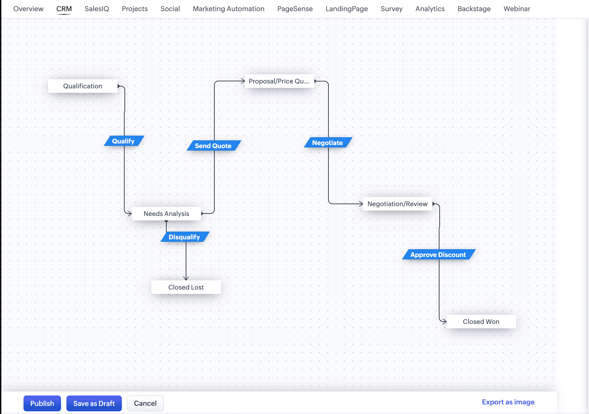
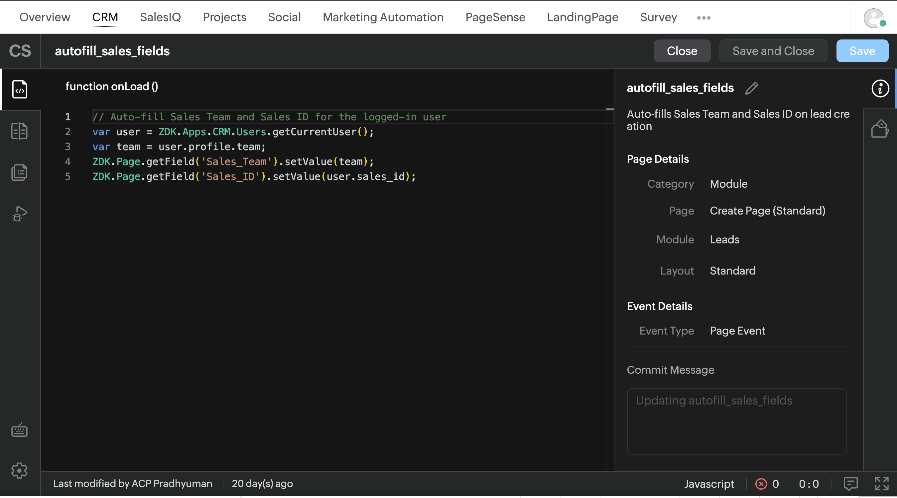

# Temperature-controlled freight carrier automates lead management and sales processes using Zoho CRM

Use Cases › Transportation & Logistics · Implemented by Customer Success

## Use case

This solution is based on a real Zoho customer. Names, details, and screenshots are anonymized to protect privacy.

The customer is one of the largest temperature-controlled truckload carriers in the United States. It transports perishable goods nationwide and offers over-the-road, regional, dedicated, intermodal, and logistics services. It also rents and sells transport equipment. Shippers use the carrier for reliable cold-chain transport, available capacity, and the ability to quote and contract freight quickly.

Sales representatives are organized by region and service line. A freight opportunity starts when a prospective shipper is added as a lead. Enquiries arrive as inbound rate requests, referrals from existing shippers, conversations at industry events, and outbound prospecting. Lead Source stores the channel. The representative qualifies the lane, capacity, and equipment. A sales team lead converts a qualified lead into an account, a contact, and a deal. On the deal, the team quotes a rate, negotiates terms, and books the freight or marks it lost.

Every record has an owner, and each representative belongs to a sales team. Sales team leads and administrators sit above the representatives. Lead conversion is limited to those roles.

As freight volume and the team grew, representatives were still tracking opportunities by hand. Ownership and follow-ups differed from one person to the next, and each representative moved a prospect to booked freight in their own way. The company adopted Zoho CRM so shippers, quotes, and opportunities sit in one system, and every opportunity follows the same process.

## Requirements

The company needed Zoho CRM to follow the sales process and the team structure already in use, so every representative works the same way and managers can see the pipeline.

The company needed to:

- Notify the owner and create a follow-up task when a new lead is added.
- Move each freight opportunity through the same stages, from qualification to booked freight.
- Show the fields that belong to the current stage, including the fields used to quote a rate and book a load.
- Let the sales team sign in with the company credentials they already use for other systems.
- Let sales team leads and administrators convert a qualified lead into an account and a deal.
- Fill the sales team and the representative’s sales identifier when a representative creates a lead.
- Create an account when an authorized user converts a lead, and reuse the existing account when that shipper is already on file.

### Features in use

Blueprint Workflow Rules Layout Rules Client Script Profiles Single sign-on

### Following up on every new lead

Workflow rules run when a lead is created. CRM emails the owner and creates a follow-up task on that lead.

### One process from qualification to booked freight

Blueprint on the Deals module sets the stage path: Qualification, Needs Analysis, Proposal/Price Quote, Negotiation/Review, and Closed Won. The Disqualify transition moves the deal to Closed Lost.

Each transition has its own rules. Quote amount and quote validity are required before a deal leaves Proposal/Price Quote. Completing a transition can email a manager and create the next task. The stage updates when the representative completes that transition. Managers can see which stage each freight opportunity is in.

### Fields for quoting and booking

Layout rules on the Deals and Leads forms show fields when that stage needs them. Rate and lane fields appear when the opportunity is at the quoting stage.

### Company sign-in

The sales team signs in to the company’s other systems with credentials held in the corporate directory. Zoho CRM uses that same directory, so representatives open CRM with their company login.

User management stays in that directory. When someone joins, changes role, or leaves, CRM access follows the company’s existing user record.

### Who can convert a lead

Converting a lead creates the account and the deal. That action is available on the sales team lead and administrator profiles. Representatives can create, qualify, and work leads, and they can move their own deals through the stage path.

### Sales team and sales identifier on new leads

A client script on the Leads create page fills the sales team and the representative’s sales identifier from the signed-in user’s profile.

### One way to create an account

Accounts were being created in two ways. Typing a company name on an incoming record created an account in the background, so the same shipper could appear more than once under slightly different spellings. Any user could also convert a lead and add an account while the prospect was still in qualification.

The company name is now saved on the incoming record. An account is created when a sales team lead or administrator converts the lead. At conversion, the team can match the shipper to an account already in CRM and reuse it.

## Result

The implementation helped the company:

- Follow up on every new lead, with an email to the owner and a task.
- Run every opportunity through one sales process, from qualification to booked freight.
- Show rate and lane fields at the quoting stage.
- Sign the sales team in with existing company credentials, with access managed in the company directory.
- Reserve lead conversion for sales team leads and administrators.
- Fill sales team and sales identifier from the signed-in user.
- Create accounts through lead conversion, and reuse an existing shipper when the account is already there.

*Please note that the solution described here is developed for a real use case of a Zoho customer. All names, identifying details, and screenshots have been anonymized to protect privacy.*
